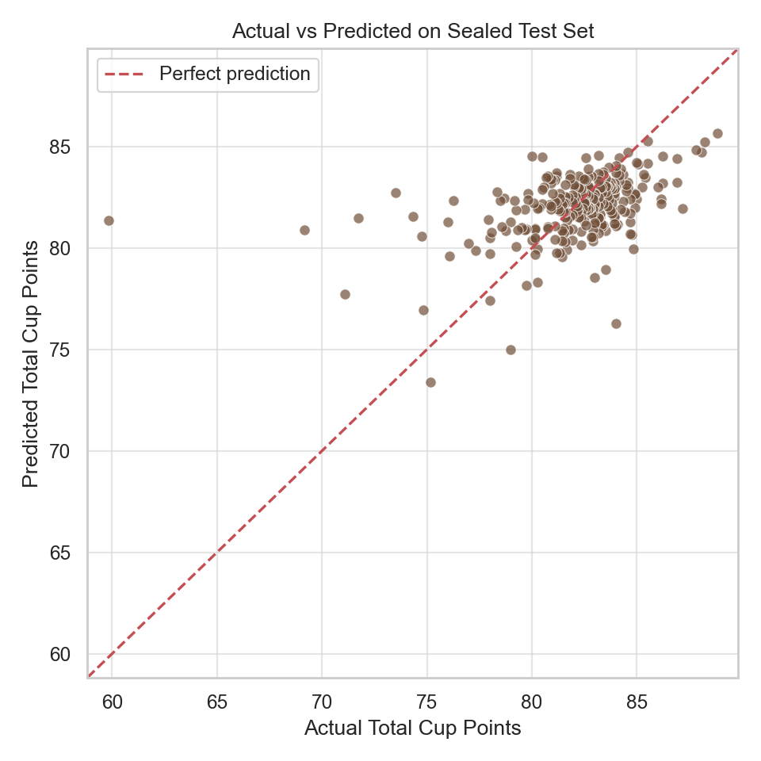

# Coffee Quality Prediction with an MLP

用咖啡元数据预测杯测总分（`Total.Cup.Points`）的机器学习学习项目，基于 scikit-learn 的多层感知机回归模型。

## 项目内容

- 数据审计、异常值处理与缺失值填补。
- 使用 7 个数值特征和 6 个类别特征；排除构成目标的杯测子分数及源行号，降低目标泄漏风险。
- 按 60% / 20% / 20% 划分训练、验证与测试集，用验证集选择网络结构，随后在训练与验证数据上重训。
- 输出回归指标、均值基线对比，以及 82.5 分阈值下的派生品质筛选指标。

## 已保存的实验结果

以下来自原项目的 `results_notebook/model_metrics.json`，整理发布时未重新训练。

| 模型 | MAE ↓ | RMSE ↓ | R² ↑ |
| --- | ---: | ---: | ---: |
| 均值基线 | 1.914 | 2.953 | -0.001 |
| MLP（128 → 64 → 32） | 1.737 | 2.662 | 0.186 |

清洗后共有 1,338 条记录；训练 / 验证 / 测试分别为 802 / 268 / 268 条。模型比均值基线的 MAE 和 RMSE 更好，但解释能力有限，仍有改进空间。该项目用于学习和实验。



## 运行

建议使用 Python 3.11。在项目根目录执行：

```bash
python -m venv .venv
# Windows PowerShell:
.venv\Scripts\Activate.ps1
# macOS / Linux:
# source .venv/bin/activate
python -m pip install -r requirements.txt
```

从数据集 `volpatto/coffee-quality-database-from-cqi` 获取 `merged_data_cleaned.csv`，放入 `data/raw/`。本发布包未包含原始数据、完整清洗数据或训练模型文件；使用数据时请核对其原始来源和授权条件。

然后运行：

```bash
python train.py
```

或者执行 `jupyter notebook`，打开 `coffee_quality.ipynb`，按顺序运行全部单元。请从项目根目录启动。Notebook 也支持可选的 `kagglehub` 下载方式，需要时自行安装该包。

训练会写入 `results_notebook/`，并生成 `.joblib` 模型。脚本中绘图可能需要关闭图窗才能继续执行；无图形界面的环境可设置 `MPLBACKEND=Agg`。

## 文件

- `coffee_quality.ipynb`：完整分析和训练过程，发布版已清除运行输出。
- `train.py`：从 Notebook 代码单元导出的脚本。
- `requirements.txt`：运行依赖，未锁定版本；不同版本可能产生不同数值结果。
- `results_notebook/`：原实验的指标、审计摘要、预测和图表。

本次整理仅验证了 Notebook JSON 结构、文件完整性及常见密钥模式；尚未在新环境执行训练。项目未添加软件许可证。
